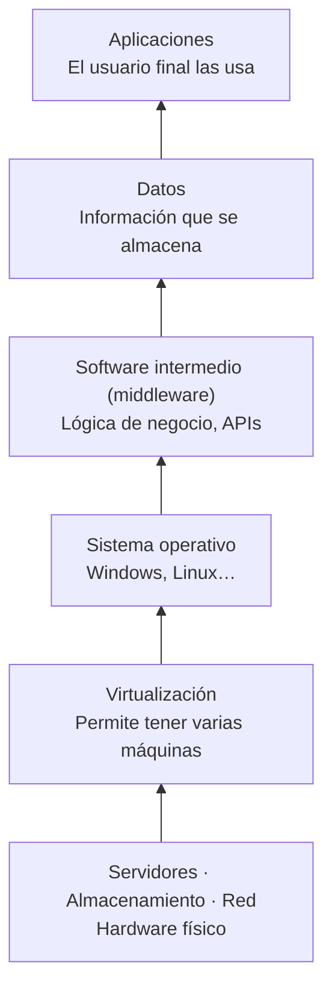
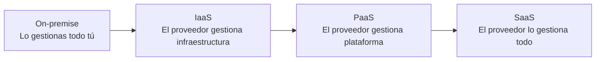
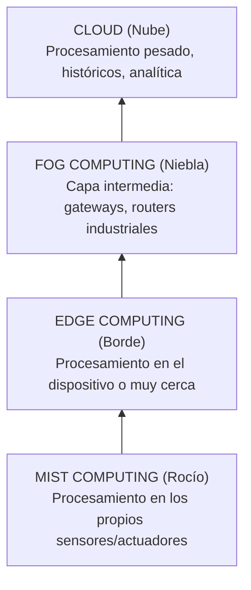
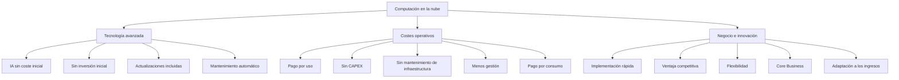

# UD3 – Computación en la nube

> Apuntes ampliados y detallados para alumnado de **FP DAW (Desarrollo de Aplicaciones Web)**.
> Material elaborado a partir de la presentación de la unidad didáctica.

---

## Índice

1. [Nos ponemos en contexto](#1-nos-ponemos-en-contexto)
2. [¿En qué consiste la computación en la nube?](#2-en-qué-consiste-la-computación-en-la-nube)
3. [Modelos de nube](#3-modelos-de-nube)
   - 3.1 [Nube pública](#31-nube-pública)
   - 3.2 [Nube privada](#32-nube-privada)
   - 3.3 [Nube híbrida](#33-nube-híbrida)
   - 3.4 [Multinube](#34-multinube)
4. [Servicios en la nube: capas](#4-servicios-en-la-nube-capas)
5. [Modelos de servicio: IaaS, PaaS, SaaS, XaaS](#5-modelos-de-servicio-iaas-paas-saas-xaas)
   - 5.1 [IaaS – Infrastructure as a Service](#51-iaas--infrastructure-as-a-service)
   - 5.2 [PaaS – Platform as a Service](#52-paas--platform-as-a-service)
   - 5.3 [SaaS – Software as a Service](#53-saas--software-as-a-service)
   - 5.4 [XaaS – Anything as a Service](#54-xaas--anything-as-a-service)
6. [Soluciones SaaS: B2B, B2C, horizontal y vertical](#6-soluciones-saas-b2b-b2c-horizontal-y-vertical)
7. [Soluciones usando cada modelo](#7-soluciones-usando-cada-modelo)
8. [Edge, Fog y Mist Computing](#8-edge-fog-y-mist-computing)
9. [Impacto en la rentabilidad de una empresa](#9-impacto-en-la-rentabilidad-de-una-empresa)
10. [Conclusiones](#10-conclusiones)
11. [Glosario de términos](#11-glosario-de-términos)

---

## 1. Nos ponemos en contexto

La computación en la nube no es algo que haya aparecido de la noche a la mañana. Es el resultado de décadas de evolución tecnológica. Repasarla nos ayuda a entender **por qué hoy en día es tan importante** y qué problemas viene a resolver.

### 1.1 Evolución histórica resumida

| Hito | Qué aportó | Por qué importa |
|------|-----------|-----------------|
| **Mainframes** (años 60-80) | Ordenadores centrales enormes a los que se conectaban terminales "tontos". | Primer modelo de computación compartida: muchos usuarios usaban un único equipo potente. |
| **PC y cliente-servidor** (años 80-90) | El ordenador personal y las redes locales (LAN). | La potencia se reparte por los escritorios. Aparecen los servidores en las empresas. |
| **Virtualización** (años 2000) | Ejecutar varios "ordenadores virtuales" dentro de un único servidor físico. | Se aprovecha mejor el hardware y se independiza el software del equipo físico. |
| **Aplicaciones web** (años 2000) | Gmail, Google Docs, Salesforce, etc. | El software se usa desde el navegador, sin instalar nada en local. |
| **Lanzamiento de AWS (2006)** | Amazon ofrece a terceros su propia infraestructura. | Nace el cloud computing comercial tal y como lo conocemos. |
| **Google Cloud Platform y Microsoft Azure** | Más proveedores compiten en el mercado. | Se abaratan los precios y mejora la calidad del servicio. |

> **Idea clave:** cada paso de esta evolución ha consistido en **externalizar** algo que antes estaba en la empresa (el ordenador central, el servidor físico, el software instalado) hacia un proveedor que lo gestiona por nosotros. La nube es el último paso de esa tendencia: externalizamos toda la infraestructura.

### 1.2 ¿Por qué ahora?

Tres motivos explican el éxito actual de la nube:

1. **Internet es rápido y está en todas partes** (fibra, 4G/5G, WiFi).
2. **La virtualización ha madurado**, permitiendo aislar recursos de forma eficiente.
3. **El modelo de pago por uso** encaja con las necesidades reales de las empresas (pagar solo por lo que se consume, como con la luz o el agua).

---

## 2. ¿En qué consiste la computación en la nube

**Definición:** la computación en la nube (*cloud computing*) es un modelo que permite acceder bajo demanda, a través de Internet, a un conjunto compartido de recursos configurables (servidores, almacenamiento, redes, aplicaciones y servicios) que pueden aprovisionarse y liberarse rápidamente con un mínimo esfuerzo de gestión o interacción con el proveedor (adaptación de la definición del NIST).

En la práctica, esto significa que:

- No necesitamos comprar ni mantener servidores propios.
- Podemos aumentar o reducir la capacidad contratada en minutos.
- Pagamos únicamente por lo que usamos.

### 2.1 Los cuatro pilares que aparecen en la unidad

1. **Recursos de hardware**: servidores, almacenamiento y redes accesibles a través de Internet. Son los "ordenadores" que ejecutan el trabajo.
2. **Recursos de software**: bases de datos, aplicaciones y servicios disponibles en línea. Son los programas que el usuario final utiliza.
3. **Beneficios ambientales**: al compartir recursos entre muchos clientes, se aprovechan mejor los equipos y se reduce el consumo energético. Es una de las grandes ventajas ecológicas del cloud.
4. **Modelos de negocio**: nuevas formas de cobrar y提供服务 basadas en suscripción, pago por uso o freemium.

### 2.2 Ejemplo cotidiano

Cuando abres **Google Drive**, **Netflix** o **Gmail**, estás usando la nube:

- No hay ningún CD de instalación.
- Tu archivo está en un servidor de Google, no en tu disco duro.
- Si entras desde otro dispositivo, ves lo mismo.
- Google se encarga de mantener los discos, hacer copias de seguridad y que el servicio esté disponible 24/7.

Eso **es** computación en la nube.

---

## 3. Modelos de nube

No todas las empresas necesitan el mismo tipo de nube. Existen cuatro modelos principales que se diferencian por **quién gestiona la infraestructura** y **dónde está ubicada**.

### 3.1 Nube pública

La infraestructura es **propiedad de un proveedor externo** (Amazon Web Services, Microsoft Azure, Google Cloud, etc.) y se comparte entre muchos clientes a través de Internet.

**Características principales:**

- **Acceso desde cualquier ubicación**: solo se necesita una conexión a Internet.
- **Escalabilidad**: se pueden aumentar o reducir los recursos (CPU, RAM, almacenamiento) en minutos, según la demanda.
- **Despliegue rápido**: crear un servidor o una base de datos tarda minutos, no semanas como en la infraestructura tradicional.

**Ventajas:**

- No requiere inversión inicial en hardware.
- Pago por uso (modelo *pay-as-you-go*).
- Mantenimiento y actualizaciones a cargo del proveedor.
- Alta disponibilidad geográfica (datacenters en todo el mundo).

**Desventajas:**

- Menor control sobre los datos y la infraestructura.
- Dependencia del proveedor (*vendor lock-in*).
- Posibles problemas de cumplimiento normativo en sectores muy regulados (sanidad, banca…).

**Ejemplo:** una startup monta su web en AWS y, cuando un vídeo se hace viral, escala automáticamente de 2 a 50 servidores sin llamar a ningún proveedor.

### 3.2 Nube privada

La infraestructura es **para uso exclusivo de una organización**. Puede estar en las propias instalaciones de la empresa (*on-premise*) o en un datacenter externo dedicado.

**Características principales:**

- **Personalización total**: se adapta a las necesidades concretas de la empresa.
- **Control absoluto**: la organización gestiona y dirige toda la infraestructura.
- **Responsabilidad financiera**: la empresa asume todos los costes (compra de hardware, electricidad, refrigeración, personal técnico).
- **Proveedores de nube privada**: VMware, OpenStack, Microsoft (con Azure Stack), etc.

**Ventajas:**

- Máximo control sobre seguridad y datos.
- Cumplimiento normativo más sencillo.
- Personalización al detalle.

**Desventajas:**

- Coste inicial elevado.
- Requiere personal cualificado para mantenerla.
- Escalado más lento y caro.

**Ejemplo:** un banco que, por regulación, no puede sacar ciertos datos de sus propios centros de datos, mantiene una nube privada con OpenStack.

### 3.3 Nube híbrida

Combina **nube pública y nube privada**, conectándolas para que trabajen juntas. Es el modelo más extendido hoy en día.

**Características principales:**

- **Carga de trabajo equilibrada**: distribuye las tareas entre la nube privada y la pública. Lo más sensible o crítico se queda en casa; lo elástico se va a la nube pública.
- **Seguridad mejorada**: los datos sensibles se mantienen en el entorno privado.
- **Cumplimiento normativo**: permite adherirse a regulaciones que obligan a tener ciertos datos en local.
- **Escalabilidad**: cuando la nube privada se queda corta, "derramamos" (*cloud bursting*) a la pública.

**Ventajas:**

- Lo mejor de ambos mundos.
- Flexibilidad para mover cargas entre entornos.
- Coste optimizado.

**Desventajas:**

- Mayor complejidad de gestión.
- Necesidad de asegurar la conexión entre las dos nubes.

**Ejemplo:** una tienda online mantiene su base de datos de clientes en la nube privada (por privacidad) pero usa AWS para absorber los picos de tráfico en Black Friday.

### 3.4 Multinube

La organización utiliza **varias nubes públicas de distintos proveedores** (AWS + Azure + Google Cloud, por ejemplo). No es lo mismo que híbrida: en la híbrida hay nube privada, en la multinube todas son públicas (aunque pueden ser de distintos proveedores).

**Características principales:**

- **Integración de nubes**: herramientas y procesos para que las distintas nubes trabajen coordinadas.
- **Diversidad de proveedores**: se evita depender de un único proveedor.
- **Selección de servicios**: se elige el mejor servicio de cada proveedor (por ejemplo, Azure para Active Directory y AWS para S3).
- **Reducción de la dependencia**: si un proveedor tiene una caída o sube precios, se puede migrar parte a otro.

**Ventajas:**

- Aprovecha las fortalezas de cada proveedor.
- Reduce el *vendor lock-in*.
- Mayor resiliencia ante caídas.

**Desventajas:**

- Gestión muy compleja.
- Costes de integración y formación.
- Necesidad de personal experto en varias plataformas.

**Ejemplo:** una gran empresa usa Azure para su Office 365, AWS para machine learning y Google Cloud para analítica de datos.

### 3.5 Cuadro comparativo

| Característica | Pública | Privada | Híbrida | Multinube |
|----------------|:-------:|:-------:|:-------:|:---------:|
| Propiedad del proveedor | Externo | Propia o dedicada | Mixto | Varios externos |
| Inversión inicial | Baja | Alta | Media | Baja |
| Escalabilidad | Muy alta | Limitada | Alta | Muy alta |
| Control | Bajo | Total | Medio | Bajo-medio |
| Cumplimiento normativo | Limitado | Alto | Alto | Medio |
| Complejidad de gestión | Baja | Alta | Alta | Muy alta |
| Riesgo de *lock-in* | Alto | Bajo | Medio | Bajo |

---

## 4. Servicios en la nube: capas

Para entender los modelos de servicio (IaaS, PaaS, SaaS…) primero hay que saber **qué capas componen un sistema informático**. La presentación muestra esta pila:

### 4.1 ¿Qué gestiona cada parte?

- **Hardware físico** (servidores, almacenamiento, red): los cables, discos y procesadores reales. Lo mantiene el proveedor en su datacenter.
- **Virtualización**: capa software que permite dividir un servidor físico en muchos servidores virtuales. La inventaron los mainframes y hoy es la base de toda la nube.
- **Sistema operativo**: Linux, Windows Server, etc. Se instala sobre la máquina virtual.
- **Middleware / software intermedio**: lógica común (servidores de aplicaciones, colas de mensajes, bases de datos).
- **Datos**: la información que manejan las aplicaciones.
- **Aplicaciones**: lo que el usuario ve y usa.

### 4.2 La idea central

Conforme vamos subiendo en la pila, **más cosas se externalizan al proveedor**. En IaaS, el proveedor solo nos da la base; en PaaS nos da también el sistema operativo y el middleware; en SaaS nos da la aplicación completa. Lo vemos con detalle en el siguiente apartado.

---

## 5. Modelos de servicio: IaaS, PaaS, SaaS, XaaS

Los modelos de servicio definen **qué gestiona el proveedor y qué gestiona el cliente**. Son los tres modelos clásicos (a veces se añaden más bajo el paraguas XaaS).

### 5.1 IaaS – Infrastructure as a Service

El proveedor ofrece **infraestructura básica de computación**: servidores virtuales, almacenamiento y redes. El cliente instala encima el sistema operativo, el middleware y las aplicaciones.

**Características principales:**

- **Servidores virtuales bajo demanda**: levantas un servidor Linux o Windows en minutos.
- **Almacenamiento elástico**: discos que crecen o encogen según necesidad.
- **Redes definidas por software**: VLANs, firewalls, balanceadores configurables.
- **Pago por uso**: pagas por las horas de CPU, GB de RAM y TB de disco consumidos.
- **Control total sobre el sistema operativo**: puedes instalar lo que quieras.

**Ejemplos de proveedores:**

- **Amazon Web Services (AWS)**: EC2, S3, VPC.
- **Microsoft Azure**: Virtual Machines, Blob Storage.
- **Google Cloud Platform (GCP)**: Compute Engine, Cloud Storage.
- **Proveedores europeos**: OVHcloud, Hetzner Cloud, Arsys.

**Cuándo elegir IaaS:**

- Necesitas un control total sobre el sistema operativo.
- Vas a migrar una aplicación legacy que no encaja en PaaS.
- Quieres máxima flexibilidad y estás dispuesto a asumir más trabajo de administración.

### 5.2 PaaS – Platform as a Service

El proveedor ofrece una **plataforma completa para desarrollar y desplegar aplicaciones**, incluyendo el sistema operativo, el middleware, las bases de datos y las herramientas de desarrollo. El cliente solo se ocupa del código de su aplicación y de los datos.

**Características principales:**

- **Entorno de desarrollo integrado**: SDK, bibliotecas, herramientas listas para usar.
- **Despliegue simplificado**: subir el código y la plataforma se encarga del resto.
- **Escalado automático**: si entran más usuarios, la plataforma añade recursos sola.
- **Servicios gestionados**: bases de datos, colas de mensajes, caché, etc., sin que el cliente los administre.
- **Alta disponibilidad**: replicación y balanceo incluidos por defecto.

**Ejemplos de proveedores:**

- **Heroku** (parte de Salesforce).
- **Google App Engine**.
- **AWS Elastic Beanstalk**, **Azure App Service**.
- **Vercel**, **Netlify** (especializados en frontend).
- **Render**, **Fly.io**.

**Cuándo elegir PaaS:**

- Eres desarrollador y quieres centrarte en el código, no en la infraestructura.
- Tu aplicación es nueva y no tiene requisitos especiales de sistema operativo.
- Quieres iterar rápido: subir cambios y verlos en producción en minutos.

### 5.3 SaaS – Software as a Service

El proveedor ofrece **aplicaciones completas listas para usar**, a las que el cliente accede normalmente desde un navegador web. El cliente no se preocupa de nada: ni del sistema operativo, ni del servidor, ni del mantenimiento.

**Características principales:**

- **Acceso vía navegador o app móvil**: nada que instalar.
- **Pago por suscripción** (mensual/anual) o por usuario.
- **Actualizaciones automáticas**: siempre se usa la última versión.
- **Multi-tenant**: una sola instancia de la aplicación sirve a muchos clientes, que ven sus datos aislados.
- **Accesible desde cualquier lugar** con conexión a Internet.

**Ejemplos muy conocidos:**

- **Productividad**: Google Workspace (Docs, Sheets, Gmail), Microsoft 365.
- **CRM**: Salesforce, HubSpot.
- **Comunicación**: Slack, Microsoft Teams, Zoom.
- **Almacenamiento**: Dropbox, Google Drive, OneDrive.
- **Gestión de proyectos**: Trello, Asana, Monday.

**Cuándo elegir SaaS:**

- La aplicación que necesitas ya existe como servicio.
- No quieres (o no puedes) mantener infraestructura.
- Valoras el acceso desde cualquier lugar y el trabajo colaborativo.

### 5.4 XaaS – Anything as a Service

Es un **término paraguas** (*anything as a service*, "cualquier cosa como servicio") que engloba todo lo que pueda entregarse bajo demanda a través de la nube. Nació como evolución natural de IaaS, PaaS y SaaS.

**Otros "as a Service" habituales:**

| Modelo | Significado | Ejemplo |
|--------|-------------|---------|
| **FaaS** | Function as a Service (sin servidor / *serverless*) | AWS Lambda, Azure Functions |
| **DBaaS** | Database as a Service | Amazon RDS, Firebase |
| **StaaS** | Storage as a Service | Dropbox, Backblaze |
| **BaaS** | Backend as a Service | Firebase, Supabase |
| **MaaS** | Monitoring/ML as a Service | Datadog, AWS SageMaker |
| **DaaS** | Desktop as a Service (escritorios virtuales) | Citrix, Azure Virtual Desktop |
| **CaaS** | Containers as a Service | Amazon ECS, Google Kubernetes Engine |
| **SECaaS** | Security as a Service | Cloudflare, Snyk |

> **Idea clave:** la tendencia es que **todo** se ofrezca como servicio. Esto refleja la idea central de la nube: en lugar de comprar y mantener, **contratas y consumes**.

### 5.5 Comparativa IaaS / PaaS / SaaS

| Capa | IaaS | PaaS | SaaS |
|------|:----:|:----:|:----:|
| Aplicación | Cliente | Cliente | Proveedor |
| Datos | Cliente | Cliente | Cliente |
| Middleware | Cliente | Proveedor | Proveedor |
| Sistema operativo | Cliente | Proveedor | Proveedor |
| Virtualización | Proveedor | Proveedor | Proveedor |
| Hardware | Proveedor | Proveedor | Proveedor |
| Control | Alto | Medio | Bajo |
| Facilidad de uso | Baja | Media | Alta |
| Flexibilidad | Muy alta | Alta | Baja |
| Para quién | Sysadmins | Desarrolladores | Usuarios finales |

---

## 6. Soluciones SaaS: B2B, B2C, horizontal y vertical

Dentro del mundo SaaS existen dos ejes de clasificación muy útiles: **a quién se vende** (B2B vs B2C) y **para qué sector sirve** (horizontal vs vertical).

### 6.1 SaaS B2B (Business to Business)

Soluciones SaaS **enfocadas a servir las necesidades específicas de las empresas**.

**Características:**

- Pensadas para equipos de trabajo, no para usuarios individuales.
- Integración con otras herramientas corporativas (ERP, CRM, etc.).
- Modelos de precio por usuario o por uso empresarial.
- Cuentas con permisos, roles y auditoría.

**Ejemplos:**

- **CRM**: Salesforce, HubSpot CRM.
- **Marketing automation**: Mailchimp, Marketo.
- **Gestión de proyectos**: Asana, Monday.com, Jira.
- **RR. HH.**: Workday, BambooHR.
- **Facturación y contabilidad**: Holded, QuickBooks Online.

### 6.2 SaaS B2C (Business to Consumer)

Soluciones SaaS **enfocadas a servir directamente a consumidores finales**, en su vida personal o de ocio.

**Características:**

- Pensadas para un usuario individual o una familia.
- Interfaz muy sencilla e intuitiva.
- Modelos de precio freemium o por suscripción personal.
- Poca o nula necesidad de integraciones corporativas.

**Ejemplos:**

- **Streaming de vídeo**: Netflix, Disney+, HBO Max.
- **Streaming de música**: Spotify, Apple Music.
- **Mensajería**: WhatsApp (en parte), Telegram, Signal.
- **Almacenamiento personal**: Google Drive, iCloud, Dropbox.
- **Productividad personal**: Notion, Evernote.

### 6.3 SaaS Horizontal

Soluciones **diseñadas para necesidades empresariales generales**, aplicables a **cualquier sector**.

**Características:**

- Resuelven problemas comunes a todas las empresas (gestionar clientes, tareas, comunicación…).
- Gran mercado potencial.
- Suelen ser configurables y personalizables.

**Ejemplos:**

- CRM (gestión de clientes) → Salesforce, HubSpot.
- ERP (planificación de recursos) → Odoo, SAP Business One.
- Herramientas de comunicación → Slack, Microsoft Teams.
- Suites ofimáticas → Google Workspace, Microsoft 365.

### 6.4 SaaS Vertical

Soluciones **especializadas para un nicho de mercado o sector concreto**, con funcionalidades adaptadas a su regulación, lenguaje y procesos específicos.

**Características:**

- Conocen en profundidad el sector al que sirven.
- Incluyen plantillas, informes y métricas propias del nicho.
- Menor competencia porque el mercado es más pequeño.
- Precio más alto por la especialización.

**Ejemplos:**

- **Sanidad**: software de gestión de clínicas, historiales clínicos.
- **Educación**: plataformas LMS como Moodle, plataformas de gestión de centros.
- **Hostelería**: TPV en la nube como CoverManager, TheFork.
- **Legal**: software para despachos de abogados (time tracking, facturación por expediente).
- **Construcción**: software de presupuestos y mediciones para obras.

### 6.5 Cuadro resumen SaaS

|             | B2B | B2C |
|-------------|-----|-----|
| **Horizontal** | CRM, ERP, ofimática empresarial | Streaming, correo personal |
| **Vertical**   | Software para clínicas, software legal | Apps de salud, apps de idiomas |

---

## 7. Soluciones usando cada modelo

### 7.1 Soluciones IaaS

Cuando contratamos IaaS, lo que obtenemos son **piezas de infraestructura** que nosotros configuramos.

**1. Servicios de computación**

- Ofrecen recursos de procesamiento de datos: **CPU** y **GPU**.
- Casos de uso: ejecutar máquinas virtuales, entrenar modelos de inteligencia artificial (con GPU), levantar servidores web.
- Ejemplo: AWS EC2 (CPU), AWS P3 (GPU).

**2. Servicios de almacenamiento**

- Proporcionan espacios para guardar datos en la nube.
- Tipos: almacenamiento de objetos (S3), de archivos (EFS), de bloques (EBS).
- Casos de uso: copias de seguridad, archivos multimedia, Big Data.
- Ejemplo: Amazon S3, Google Cloud Storage.

**3. Servicios de copia de seguridad**

- Soluciones para proteger datos mediante **backups automatizados**.
- Permiten restaurar la información en caso de desastre.
- Ejemplo: AWS Backup, Azure Backup, Veeam Cloud Connect.

**4. Servicios de red**

- Infraestructura de red en la nube para conectividad.
- Incluyen: VPC (redes privadas virtuales), balanceadores de carga, VPN, CDN, DNS gestionado.
- Ejemplo: Amazon VPC, Azure Virtual Network, Google Cloud CDN.

### 7.2 Soluciones PaaS

Cuando contratamos PaaS, el objetivo es **desarrollar y desplegar aplicaciones** sin preocuparnos por la infraestructura.

**1. Gestión del ciclo de vida de aplicaciones (ALM)**

- Integra la **planificación, desarrollo, pruebas, despliegue y mantenimiento** del software.
- Incluye control de versiones, integración continua (CI) y despliegue continuo (CD).
- Ejemplo: Azure DevOps, GitLab, GitHub Actions.

**2. Portales de aplicaciones**

- Proveen **infraestructura y herramientas** para desarrollar y hospedar **portales web empresariales**.
- Incluyen hosting, plantillas, autenticación y bases de datos.
- Ejemplo: Microsoft Power Pages, Google Sites (versión empresarial), WordPress VIP.

**3. Plataformas de desarrollo de aplicaciones sin servidor (*serverless*)**

- Permiten desarrollar **sin gestionar la infraestructura subyacente**.
- El código se ejecuta en respuesta a eventos.
- Escala automáticamente con la demanda.
- Ejemplo: AWS Lambda, Azure Functions, Google Cloud Functions, Vercel Functions.

### 7.3 Soluciones SaaS

Las soluciones SaaS que se estudian en la unidad se agrupan en seis grandes familias:

| Familia | Qué resuelve | Ejemplos |
|---------|--------------|----------|
| **Software de comunicación** | Mejoran la comunicación y colaboración en equipos | Slack, Microsoft Teams, Zoom, Google Meet |
| **Suites de gestión integral de empresas (ERP/CRM)** | Soluciones completas para gestionar una empresa | Salesforce, HubSpot, SAP, Odoo, Zoho |
| **Paquetes de aplicaciones en la nube** | Software empaquetado listo para usar, sin instalación | Google Workspace, Microsoft 365, Adobe Creative Cloud |
| **Gestión empresarial** | Software para gestionar y analizar la información de la empresa | ERP como SAP, Oracle Cloud, NetSuite |
| **Marketing** | Herramientas para la gestión y análisis de marketing | HubSpot Marketing, Mailchimp, Google Analytics, Hootsuite |
| **Gestión de proyectos** | Servicios para la planificación y seguimiento de proyectos | Trello, Asana, Monday.com, Jira, ClickUp |

---

## 8. Edge, Fog y Mist Computing

A medida que Internet de las Cosas (IoT) y los dispositivos conectados se multiplican, surge un problema: **no toda la información puede (o debe) viajar hasta la nube central**. Necesitamos procesar datos **cerca de donde se generan**.

Aparecen entonces tres modelos complementarios al cloud tradicional:

### 8.1 Edge Computing

**Definición:** el procesamiento se realiza **en el extremo de la red**, lo más cerca posible del dispositivo que genera los datos.

- Reduce la latencia (los datos no tienen que viajar a un datacenter lejano).
- Disminuye el uso de ancho de banda.
- Permite operar aunque la conexión a Internet falle.
- Casos de uso: coches autónomos, cámaras inteligentes, robots industriales, farolas inteligentes.

**Ejemplo:** una cámara de seguridad con IA que detecta intrusos y envía solo las alertas, no el vídeo entero.

### 8.2 Fog Computing

**Definición:** es una **capa intermedia** entre el edge y la nube. El procesamiento se reparte entre dispositivos edge y una infraestructura local (gateways, routers industriales, servidores locales).

- Nodo central coordinador: recoge datos de muchos dispositivos edge.
- Aplica reglas y preprocesa la información antes de enviarla a la nube.
- Muy usado en industria 4.0, smart cities y agricultura de precisión.
- Estándar de referencia: **OpenFog Consortium** (ahora parte de la Industrial Internet Consortium).

**Ejemplo:** en una fábrica inteligente, los sensores de cada máquina envían datos a un gateway local (fog), que detecta anomalías y solo envía a la nube los eventos relevantes.

### 8.3 Mist Computing

**Definición:** lleva el procesamiento **al extremo absoluto**: a los propios sensores y microcontroladores. Es la capa más cercana al dato.

- Requiere dispositivos muy pequeños y de bajo consumo.
- Apto para redes de sensores masivas (WSN – Wireless Sensor Networks).
- Limitado en capacidad: solo ejecuta lógica muy sencilla.

**Ejemplo:** un sensor de temperatura que, además de medir, puede decidir por sí mismo si la lectura supera un umbral y avisar al gateway sin esperar instrucciones.

### 8.4 Cuadro comparativo

| Característica | Cloud | Fog | Edge | Mist |
|----------------|:-----:|:---:|:----:|:----:|
| Ubicación del procesamiento | Datacenter lejano | Red local | Dispositivo o muy cerca | Sensor/microcontrolador |
| Latencia | Alta | Media | Baja | Muy baja |
| Capacidad de cómputo | Muy alta | Alta | Media | Muy baja |
| Almacenamiento | Ilimitado (en la práctica) | Grande | Medio | Mínimo |
| Conectividad | Siempre online | A veces | A veces | A veces |
| Casos típicos | Big Data, IA pesada | Industria 4.0 | Coches, robots | Sensores IoT |

> **Idea clave:** estas tres capas **no sustituyen a la nube**, la complementan. La nube sigue siendo el lugar donde se almacenan historiales y se entrenan modelos; edge, fog y mist permiten **reaccionar en tiempo real**.

---

## 9. Impacto de la computación en la nube en la rentabilidad de una empresa

La unidad cierra con un mapa conceptual que resume las ventajas económicas y estratégicas de la nube para una empresa. Las organizamos en cuatro grandes bloques.

### 9.1 Acceso a tecnología avanzada

- **Innovación sin coste inicial**: se pueden probar servicios punteros (IA, blockchain, analítica avanzada) sin comprar hardware.
- **Mantenimiento automático**: el proveedor actualiza, parchea y mantiene los sistemas.
- **Últimas capacidades tecnológicas disponibles**: cualquier empresa, grande o pequeña, accede a la misma tecnología que usan los gigantes.
- **Actualizaciones incluidas**: siempre se trabaja con la última versión.

### 9.2 Reducción de costes operativos

- **Modelo de costes eficiente**: se paga solo por lo que se consume.
- **Pago por consumo**: como la luz o el agua.
- **Externalización de infraestructura**: el datacenter ya no es "problema" de la empresa.
- **Eliminación de inversiones iniciales**: no hace falta comprar servidores por adelantado.
- **Reducción de gastos de gestión**: menos personal dedicado a mantener hardware.

### 9.3 Escalabilidad y adaptabilidad

- **Adaptación a la demanda**: recursos que crecen y decrecen según la necesidad.
- **Gestión de picos de carga**: Black Friday, eventos virales, campañas de marketing, etc.
- **Eficiencia operativa**: ajustar capacidad a la carga real evita sobrecostes.
- **Acceso a tecnologías avanzadas** sin tener que dominar su mantenimiento.
- **Optimización de recursos**: nada está infrautilizado.

### 9.4 Focalización en la innovación

- **Implementación rápida**: nuevos proyectos en horas, no en meses.
- **Ventaja competitiva**: la empresa se centra en su negocio principal (*core business*) y deja la infraestructura en manos de expertos.
- **Flexibilidad de pago por uso**: el coste se adapta a los ingresos.
- **Adaptación a ingresos**: en meses malos, los costes cloud bajan; en meses buenos, suben.
- **Evitar compromisos a largo plazo**: nada de inversiones en hardware que se quedan obsoletos.
- **Concentración en el Core Business**: la empresa invierte tiempo y dinero en lo que sabe hacer, no en mantener servidores.
- **Mejora de la eficiencia global**: todos los puntos anteriores se traducen en una empresa más rentable.

### 9.5 Resumen visual

---

## 10. Conclusiones

1. **Existen diferentes modelos de computación en la nube, cada uno con sus ventajas y aplicaciones según las necesidades de cada organización**: pública, privada, híbrida y multinube. Elegir uno u otro depende del equilibrio entre control, coste, escalabilidad y cumplimiento normativo.

2. **Los modelos Edge Computing, y sus variantes Fog Computing y Mist Computing, complementan el modelo tradicional de nube**: no lo sustituyen, sino que llevan el procesamiento allí donde se generan los datos, reduciendo latencia y consumo de ancho de banda.

3. **La adopción de la nube impacta directamente en la rentabilidad empresarial**: reduce costes, mejora la eficiencia, libera recursos para la innovación y permite escalar con agilidad.

4. **La clave está en elegir el modelo adecuado para cada caso**: no hay una solución única. Una pyme, un banco y una startup de IA tienen necesidades muy distintas. Lo importante es entender las opciones y combinarlas con criterio.

---

## 11. Glosario de términos

- **BaaS (Backend as a Service)**: servicios backend listos para usar (autenticación, bases de datos, notificaciones) sin tener que programarlos.
- **Cloud bursting**: técnica híbrida que "derrama" carga a la nube pública cuando la privada se queda corta.
- **Cloud computing**: modelo de computación basado en el acceso bajo demanda, a través de Internet, a recursos compartidos configurables.
- **CRM (Customer Relationship Management)**: software para gestionar la relación con los clientes.
- **DevOps**: conjunto de prácticas que unen desarrollo (Dev) y operaciones (Ops) para entregar software más rápido y fiable.
- **FaaS (Function as a Service)**: modelo *serverless* donde se ejecutan funciones individuales en respuesta a eventos.
- **IaaS (Infrastructure as a Service)**: el proveedor ofrece infraestructura (servidores, almacenamiento, red) y el cliente gestiona el resto.
- **Latencia**: tiempo que tarda un dato en viajar desde el origen hasta su destino.
- **Multi-tenant**: arquitectura donde una sola instancia de software sirve a varios clientes, con sus datos aislados.
- **NIST**: National Institute of Standards and Technology (EE. UU.). Publicó la definición canónica de cloud computing.
- **PaaS (Platform as a Service)**: el proveedor ofrece una plataforma completa para desarrollar y desplegar aplicaciones.
- **Pay-as-you-go**: modelo de pago por uso real, sin compromisos a largo plazo.
- **SaaS (Software as a Service)**: aplicaciones completas listas para usar, accesibles desde el navegador.
- **Serverless**: modelo donde el desarrollador solo escribe el código; el proveedor ejecuta y escala automáticamente.
- **Vendor lock-in**: dependencia excesiva de un proveedor tecnológico que dificulta migrar a otro.
- **Virtualización**: técnica que permite ejecutar varios "ordenadores virtuales" sobre un único equipo físico.
- **XaaS (Anything as a Service)**: término paraguas que engloba cualquier cosa entregada como servicio en la nube.

---

> **Nota para el alumnado:** estos apuntes amplían la presentación de la UD3 con definiciones, ejemplos y cuadros comparativos. Se recomienda combinar este material con la documentación de la presentación así como la documentación oficial de proveedores en la nube (AWS, Azure, Google Cloud) para profundizar en cada modelo y servicio.